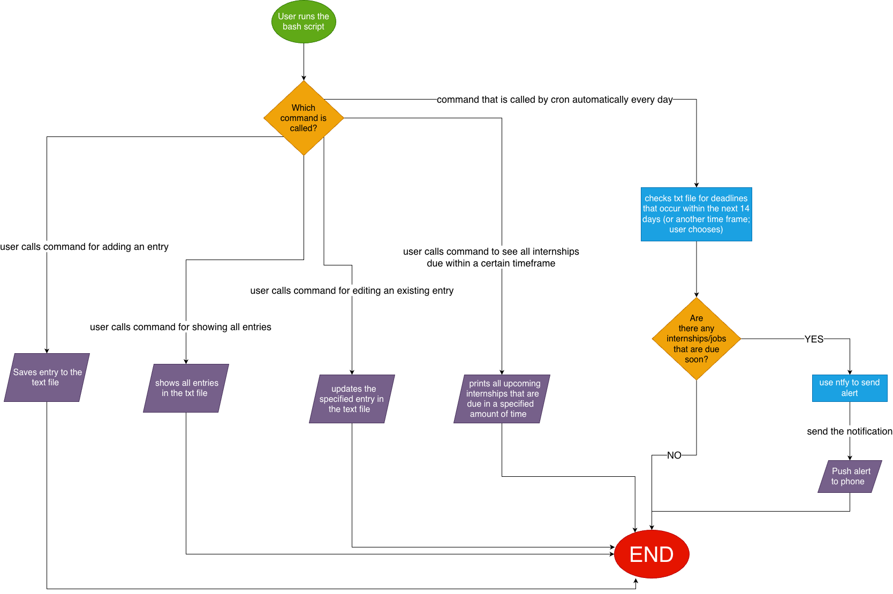

# Job Pinger

A tool that notifies users about upcoming internship application due dates.

## The Problem

Users that apply to a myriad of internships may lose track of where they applied to and by when they should receive an answer. They may also forget that an internship application is due on a specific date and may end up forgetting to apply in time.

## How It Works

Essentially, JobPinger has five main commands that it runs. These commands allow the user to add/edit entries, list all entries, and also have JobPinger output to them the most pressing entries that have due dates coming quite soon. There is also a command run by Bash every day to check for deadlines upcoming in the next x amount of days (default is 14), and it sends a push notification to the user's phone.



## Tech Stack

- **Language:** Bash.
- **Tools:** grep, sort, awk, cron (for running the deadline check every day), date, curl, case (for the actual script), etc.
- **Data storage:** txt file.
- **External tools:** ntfy for push notifications.

## Setup

```bash
git clone https://github.com/acordero1/JobPinger.git
cd JobPinger
# THE REST IS TBD!
```

## Usage

TBD

## Roadmap
- Pull new internship opportunities from an API
- Interactive menus (e.g. choose 1 for Option 1, 2 for Option 2, etc.) instead of typing everything in one long command
- Tracking OA dates separately from internship due dates

## Author

Alejandro Cordero, https://github.com/acordero1/